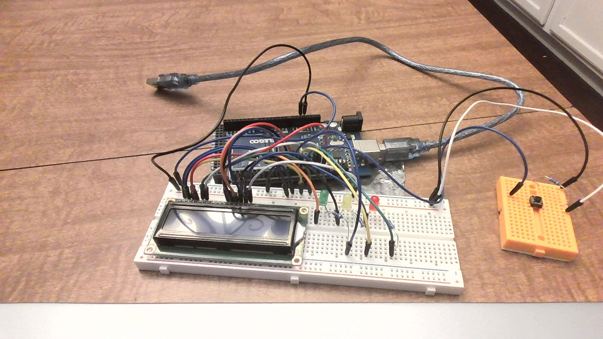

# [ARDUINO]Reaction Time Test
## About

Test your reaction time with Arduino.

## How to Use

First, download the Arduino IDE if you don't have it. Then, go to the file called "Reaction_Time_test.ino" and copy and paste that into the Arduino IDE. Finally, upload a "Liquid Crystal" library. The wiring is listed below with a diagram and picture.

## Building

### Parts Needed

- Any Arduino board.
- A breadboard.
- An Arduino LCD.
- 23 wires.
- An LED(red)
- An LED(yellow)
- An LED(green)
- A button.
- 3 220 ohm resistors.
- 1 10k ohm resistor.

### Diagram

### Picture

## Created With

- Arduino IDE
- Arduino Kit

## Author and Programmer

Michael Cook
